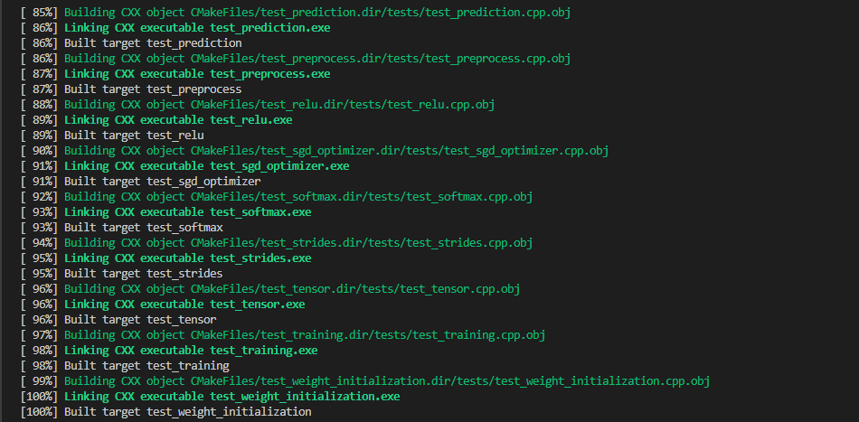
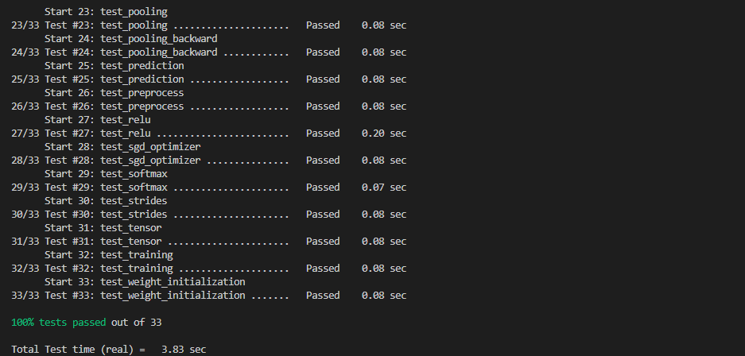

# FINAL PROJECT REPORT
   **GROUP 10**
   **Convolutional Neural Network (CNN) From Scratch in C++**

   |#|NAME|COURSE|REGISTRATION NUMBER|
|------------|----------|--------|------------|
|1.|TINDYEBWA FRANK|BCCE|25/U/08788/PS|
|2.|KWEYAMBA PETER|BCCE|25/U/08736/PS|
|3.|ATUGONZA JEREMY|BCCE|25/U/02151/PS|
|4.|MUGENYI EDRINE|BCCE|25/U/08751/PS|
|5.|NAMUKASA AGATHA|BCCE|25/U/17893/PS|
|6.|SSEMPEWO EVALISTER|BELE|25/U/08618/PS|
|7.|MUGARURA ALLAN|BCCE|25/U/08750/PS|
|8.|WANYENZE JOAN NATSEBA|BCCE|25/U/08792/PS|

---

## 1. Executive Summary
This project presents the design, implementation, and validation of a Convolutional Neural Network (CNN) built entirely from scratch in pure C++. By deliberately avoiding high-level deep learning frameworks such as TensorFlow or PyTorch, the team engaged directly with raw memory management, multidimensional tensor mathematics, and the calculus of backpropagation. 

The resulting artifact is a modular, highly reusable static library (`cnn_lib`) featuring a clean functional API, comprehensive unit testing, and demonstrative applications.

### 1.1 Project Objectives
*   **Architectural Integrity:** Design a modular C++ library (`cnn_lib`) with a strictly separated public API (`include/`) and internal implementations (`src/`).
*   **First-Principles Engineering:** Implement OOP principles, contiguous memory allocation, and mathematical formulations without external matrix libraries.
*   **Rigorous Validation:** Verify every component using 33 dedicated unit tests driven by CMake and CTest.

---

## 2. Library Architecture

### 2.1 Directory Structure
The project adheres to professional C++ directory conventions, ensuring that the core logic is entirely decoupled from the test suites and demonstration programs.

ConvolutionalNeuralNetwork/
├── CMakeLists.txt
├── include/                  # Public API headers
│   ├── tensor.hpp
│   ├── conv2d.hpp
│   ├── pooling.hpp
│   ├── fully_connected.hpp
│   └── ...
├── src/                      # Internal C++ implementations
│   └── ...
├── tests/                    # 33 Unit Test suites
│   └── ...
├── examples/                 # Demonstration applications
│   └── cnn_final_app.cpp
└── reports/                  # Project documentation
```

### 2.2 Design Paradigm
The library utilizes a **Functional API** for its mathematical operations. Rather than relying on hidden global state, functions such as `fullyConnectedBackward()` accept weights, inputs, and upstream gradients as arguments, returning the computed gradients. This stateless design ensures the library is thread-safe, predictable, and highly reusable.

---

## 3. Class Deconstruction & Implementation Details

### Module A: The Core Tensor Class (`Tensor`)
1. **Creation:** `Tensor` (representing 4D data blocks: \(N \times C \times H \times W\)).
2. **Rationale:** To store raw images and feature maps in contiguous memory blocks, facilitating efficient multidimensional indexing across batch size, channels, and spatial dimensions.
3. **Data Held:** 
    *   `vector<double> data`: A 1D contiguous vector storing all floating-point values.
    *   `vector<size_t> shape`: Dimensions vector `{N, C, H, W}`.
4. **Core Functions:**
    *   `Tensor(...)`: Allocates memory based on the requested shape.
    *   `operator()(n, c, h, w)`: Provides multi-index element access.
    *   Flattening and gradient allocation helpers.
5. **Encapsulation:** Public indexing operators allow seamless interaction from convolutional layers, while the raw `data` vector remains encapsulated to prevent unintended memory corruption.

### Module B: Two-Dimensional Convolution (`Conv2D`)
1. **Creation:** `Conv2D` (handles multi-channel convolution, kernels, strides, and zero-padding).
2. **Rationale:** To extract spatial features from input tensors using learnable filter weights.
3. **Data Held:** `Tensor weights` \((out\_channels, in\_channels, k\_h, k\_w)\), `Tensor biases`, and spatial hyperparameters (`stride`, `padding`).
4. **Core Functions:** `forward()` computes sliding-window dot products; `backward()` computes gradients with respect to weights, biases, and inputs.
5. **Encapsulation:** Intermediate cache states (like padded inputs) are kept private to ensure the mathematical state is preserved securely during backpropagation.

### Module C: Pooling Layers (`Pooling`)
1. **Creation:** `Pooling` (supports Max and Average Pooling).
2. **Rationale:** To downsample feature maps, reduce spatial dimensions, and introduce translational invariance.
3. **Data Held:** Configuration parameters (`pool_size`, `stride`) and the pooling `mode`.
4. **Core Functions:** `forward()` extracts max/average values; `backward()` routes gradients exclusively to the positions of the original maximum values.
5. **Encapsulation:** Index tracking matrices used during the backward pass are protected to prevent external tampering.

### Module D: Fully Connected Layer (`FullyConnected`)
1. **Creation:** `FullyConnected` (Dense layer).
2. **Rationale:** To map flattened feature representations into final class logits for classification.
3. **Data Held:** `weights`, `biases`, and cached inputs/outputs.
4. **Core Functions:** `forward()` handles the matrix multiplication \(z = Wx + b\); `backward()` computes weight/bias gradients and propagates the error.
5. **Encapsulation:** Weight initialization states and intermediate activation caches are kept strictly private.

---

## 4. Build & Compilation Success
The project utilizes CMake to build the static `cnn_lib` and link it against the examples and tests. The build pipeline guarantees strict adherence to C++17 standards (`-Wall -Wextra -Wpedantic`). 

The following figure demonstrates a clean, error-free compilation of the entire library, all 33 test executables, and the demonstration applications.

## Build & Compilation steps (via terminal)
1. **cmake -S . -B build -G "MinGW Makefiles"*
2. **cmake --build build*


*(Figure 1: Terminal output confirming a 100% successful build across all targets.)*

---

## 5. Testing Approach & Results

### 5.1 Testing Framework
A custom C++ unit testing framework was developed and integrated with CMake and CTest. The testing suite ensures that memory boundaries, gradient calculations, and spatial dimensions are mathematically exact.

### 5.2 Test Coverage
**33 dedicated test suites** cover every module:
*   **Core Math:** Tensor allocation, indexing, and strides.
*   **Spatial Layers:** Padding, single/multi-channel convolutions, max/average pooling.
*   **Dense Layers:** Fully connected forward/backward passes, Softmax numerical stability, and Cross-Entropy loss.
*   **Optimization:** Complete backpropagation loops and SGD optimization.

## Testing steps (via terminal)
1. **ctest --test-dir build --output-on-failure*

### 5.3 Results
The testing suite executes in under 2 seconds and yields a **100% pass rate (33/33 tests passed)**.


*(Figure 2: CTest execution results confirming 100% test success.)*

---

## 6. Team Contributions & Collaboration
*   **Frank (Team Lead):** Dataset parsing, image loading engine, loss gradients, Softmax backprop.
*   **Peter (Operations Lead):** Image preprocessing, stride mechanics, Fully Connected forward pass.
*   **Jeremy:** Image representation structures, ReLU activation, Xavier/He weight initialization.
*   **Agatha:** Tensor vector math, Sigmoid/Tanh activations, Softmax numerical stability.
*   **Mugarura:** Filter initialization, Max Pooling, Cross-Entropy loss.
*   **Joan:** 2D convolution sliding window math, Average Pooling, Argmax prediction.
*   **Evarista:** Multi-channel convolution, Feature extraction blocks, SGD optimizer.
*   **Edrine (Integration Lead):** Convolution pipeline integration, Mini-batch training loop, and final application packaging.

---

## 7. AI Use Declaration
*   **Tool:** Advanced AI assistant (Gemini).
*   **Purpose:** Architecture brainstorming, debugging memory boundaries in convolution loops, reviewing C++ tensor indexing formulas, and structuring documentation guidelines.
*   **Reason:** To accelerate syntax verification and ensure adherence to clean C++ design patterns while maintaining full team comprehension of all code written.


## 1. WEEK ONE: DATA INFRASTRUCTURE, TENSORS AND BASIC CONVOLUTION

| Member        | Tasks and Responsibilities                                                                                    | Files Added / Associated Files                                                                                           |
| ------------- | ------------------------------------------------------------------------------------------------------------- | ------------------------------------------------------------------------------------------------------------------------ |
| Frank (M1)    | Developed the image loading mechanism for reading image files and making image data available to the CNN.     | `include/image_loader.hpp`, `src/image_loader.cpp`, `include/stb_image.hpp`, `tests/test_image_loader.cpp`               |
| Peter (M2)    | Worked on image preprocessing, including normalization, channel ordering and colour conversion.               | `include/preprocess.hpp`, `tests/test_preprocess.cpp`, `examples/preprocess_demo.cpp`                                    |
| Jeremy (M3)   | Implemented image representation, including image dimensions, channels, pixel storage and pixel access.       | `include/image.hpp`, `src/image.cpp`, `tests/test_image.cpp`                                                             |
| Agatha (M4)   | Implemented the four-dimensional Tensor class and its basic operations for storing and manipulating CNN data. | `include/tensor.hpp`, `src/tensor.cpp`, `tests/test_tensor.cpp`                                                          |
| Mugarura (M5) | Worked on kernel and filter initialization required for convolution operations.                               | `include/filter_initialization.hpp`, `src/filter_initialization.cpp`, `tests/test_filter_initialization.cpp`             |
| Joan (M6)     | Implemented basic two-dimensional convolution using sliding windows and filter dot-product calculations.      | `include/convolution.hpp`, `src/convolution.cpp`, `tests/test_convolution.cpp`, `examples/week1_convolution_demo.cpp`    |
| Evarista (M7) | Implemented multi-channel and multi-filter convolution for processing multiple input channels and filters.    | `include/multi_channel_convolution.hpp`, `src/multi_channel_convolution.cpp`, `tests/test_multi_channel_convolution.cpp` |
| Edrine (M8)   | Integrated the initial convolution pipeline and prepared the Week One demonstration.                          | `src/cnn_forward_pipeline.cpp`, `tests/test_convolution_pipeline.cpp`, `tests/test_cnn_forward_integration.cpp`          |

## 2. WEEK TWO: PADDING, STRIDES, ACTIVATIONS AND POOLING

| Member        | Tasks and Responsibilities                                                                              | Files Added / Associated Files                                                                                                 |
| ------------- | ------------------------------------------------------------------------------------------------------- | ------------------------------------------------------------------------------------------------------------------------------ |
| Frank (M1)    | Implemented zero padding, including Valid and Same padding modes for handling convolution boundaries.   | `include/padding.hpp`, `src/padding.cpp`, `tests/test_padding.cpp`                                                             |
| Peter (M2)    | Implemented stride operations to control filter movement and subsampling across input tensors.          | `include/strides.hpp`, `src/strides.cpp`, `tests/test_strides.cpp`, `examples/stride_demo.cpp`                                 |
| Jeremy (M3)   | Implemented the Rectified Linear Unit (ReLU) activation function.                                       | `include/relu.hpp`, `src/relu.cpp`, `tests/test_relu.cpp`                                                                      |
| Agatha (M4)   | Implemented Sigmoid and Tanh activation modules for introducing non-linearity into the neural network.  | `include/activations.hpp`, `tests/test_activations.cpp`, `tests/test_activation_gradients.cpp`                                 |
| Mugarura (M5) | Implemented max pooling to reduce feature-map dimensions while tracking maximum-value positions.        | `include/max_pooling.hpp`, `src/max_pooling.cpp`, `tests/test_max_pooling.cpp`                                                 |
| Joan (M6)     | Implemented average pooling using arithmetic mean calculations over pooling windows.                    | `include/pooling.hpp`, `src/pooling.cpp`, `tests/test_average_pooling.cpp`, `tests/test_pooling.cpp`                           |
| Evarista (M7) | Developed the CNN feature-extraction block by combining convolution, activation and pooling operations. | `include/feature_block.hpp`, `src/feature_block.cpp`, `tests/test_feature_block.cpp`, `tests/test_cnn_feature_integration.cpp` |
| Edrine (M8)   | Integrated the CNN feature-extraction components and prepared the Week Two demonstration.               | `src/feature_integration.cpp`, `examples/week2_cnn_feature_demo.cpp`, `tests/test_cnn_feature_integration.cpp`                 |

## 3. WEEK THREE: DENSE LAYERS, SOFTMAX AND CLASSIFICATION

| Member        | Tasks and Responsibilities                                                                                                         | Files Added / Associated Files                                                                                                                                                                  |
| ------------- | ---------------------------------------------------------------------------------------------------------------------------------- | ----------------------------------------------------------------------------------------------------------------------------------------------------------------------------------------------- |
| Frank (M1)    | Implemented flattening to convert four-dimensional feature maps into one-dimensional feature vectors for classification.           | `include/flatten.hpp`, `src/flatten.cpp`, `tests/test_flatten.cpp`                                                                                                                              |
| Peter (M2)    | Implemented the fully connected forward pass using the mathematical operation \\(z = Wx + b\\).                                    | `include/fully_connected.hpp`, `src/fully_connected.cpp`, `tests/test_fully_connected.cpp`, `examples/fully_connected_demo.cpp`                                                                 |
| Jeremy (M3)   | Implemented weight and bias initialization using Xavier and He initialization methods.                                             | `include/weight_initialization.hpp`, `src/weight_initialization.cpp`, `tests/test_weight_initialization.cpp`                                                                                    |
| Agatha (M4)   | Implemented a numerically stable Softmax activation function for converting class scores into probabilities.                       | `include/softmax.hpp`, `tests/test_softmax.cpp`                                                                                                                                                 |
| Mugarura (M5) | Implemented the Cross-Entropy Loss function for measuring the difference between predicted probabilities and actual target labels. | `include/cross_entropy.hpp`, `src/cross_entropy.cpp`, `tests/test_cross_entropy.cpp`                                                                                                            |
| Joan (M6)     | Implemented the prediction mechanism using argmax classification to select the class with the highest probability.                 | `include/prediction.hpp`, `src/prediction.cpp`, `tests/test_prediction.cpp`                                                                                                                     |
| Evarista (M7) | Implemented classification evaluation metrics, including accuracy and precision.                                                   | `include/metrics.hpp`, `src/metrics.cpp`, `tests/test_metrics.cpp`, `examples/test_metrics_demo.cpp`                                                                                            |
| Edrine (M8)   | Integrated the complete forward CNN classification pipeline and developed the final application demonstration.                     | `include/dog_cat_model.hpp`, `src/dog_cat_model.cpp`, `examples/dog_cat_classifier.cpp`, `examples/dog_cat_predict.cpp`, `examples/cnn_final_app.cpp`, `tests/test_cnn_forward_integration.cpp` |

## 4. WEEK FOUR: BACKPROPAGATION, OPTIMIZATION AND FINAL DELIVERY

| Member        | Tasks and Responsibilities                                                                                                                    | Files Added / Associated Files                                                                                                                          |
| ------------- | --------------------------------------------------------------------------------------------------------------------------------------------- | ------------------------------------------------------------------------------------------------------------------------------------------------------- |
| Frank (M1)    | Implemented loss-gradient computation and Softmax backpropagation for calculating gradients during neural-network training.                   | `include/loss_gradient.hpp`, `src/loss_gradient.cpp`, `tests/test_loss_gradient.cpp`                                                                    |
| Peter (M2)    | Implemented fully connected layer backpropagation, calculating gradients for weights, biases and input values.                                | `include/fully_connected_backward.hpp`, `src/fully_connected_backward.cpp`, `tests/test_fully_connected_backward.cpp`                                   |
| Jeremy (M3)   | Implemented flattening backward propagation to route gradients from the classification layer back to the feature maps.                        | `include/flatten_backward.hpp`, `src/flatten_backward.cpp`, `tests/test_flatten_backward.cpp`                                                           |
| Agatha (M4)   | Worked on activation-function gradients for ReLU, Sigmoid and Tanh during backpropagation.                                                    | `tests/test_activation_gradients.cpp`, `include/activations.hpp`, `include/relu.hpp`, `src/relu.cpp`                                                    |
| Mugarura (M5) | Implemented backward propagation through max and average pooling operations, including gradient distribution.                                 | `include/pooling_backward.hpp`, `src/pooling_backward.cpp`, `tests/test_pooling_backward.cpp`                                                           |
| Joan (M6)     | Implemented convolution backward propagation for calculating filter and input gradients.                                                      | `include/convolution_backward.hpp`, `src/convolution_backward.cpp`, `tests/test_convolution_backward.cpp`                                               |
| Evarista (M7) | Implemented the Stochastic Gradient Descent (SGD) optimizer for updating network parameters using calculated gradients and the learning rate. | `include/sgd_optimizer.hpp`, `src/sgd_optimizer.cpp`, `tests/test_sgd_optimizer.cpp`                                                                    |
| Edrine (M8)   | Integrated the mini-batch training loop, epoch execution and final release components.                                                        | `include/training.hpp`, `src/training.cpp`, `tests/test_training.cpp`, `examples/fully_connected_training_demo.cpp`, `examples/week4_training_demo.cpp` |

## 5. SUMMARY OF INDIVIDUAL CONTRIBUTIONS THROUGHOUT THE PROJECT

| Member        | Week One                                            | Week Two                                   | Week Three                                              | Week Four                                                           | Overall Contribution                                                                                                                                          |
| ------------- | --------------------------------------------------- | ------------------------------------------ | ------------------------------------------------------- | ------------------------------------------------------------------- | ------------------------------------------------------------------------------------------------------------------------------------------------------------- |
| Frank (M1)    | Image loading and image I/O.                        | Padding and boundary handling.             | Flattening feature maps.                                | Loss gradients and Softmax backpropagation.                         | Developed the image input mechanism, padding operations, feature-map flattening and loss-gradient computation.                                                |
| Peter (M2)    | Image preprocessing and normalization.              | Stride and subsampling implementation.     | Fully connected forward propagation.                    | Fully connected backward propagation.                               | Prepared input images, implemented stride operations and developed forward and backward propagation for dense layers.                                         |
| Jeremy (M3)   | Image representation and pixel management.          | ReLU activation implementation.            | Weight and bias initialization.                         | Flattening backward propagation.                                    | Developed image representation, activation functionality, parameter initialization and gradient routing through flattening.                                   |
| Agatha (M4)   | Tensor class and tensor operations.                 | Sigmoid and Tanh activation modules.       | Softmax probability calculation.                        | Activation-function gradients.                                      | Developed the tensor foundation, activation functions, probability calculation and activation backpropagation.                                                |
| Mugarura (M5) | Kernel and filter initialization.                   | Max pooling implementation.                | Cross-Entropy Loss calculation.                         | Pooling backward propagation.                                       | Developed filter initialization, max pooling, loss calculation and gradient propagation through pooling operations.                                           |
| Joan (M6)     | Basic 2D convolution.                               | Average pooling implementation.            | Prediction and argmax classification.                   | Convolution backward propagation.                                   | Developed convolution, average pooling, prediction logic and convolution gradient calculations.                                                               |
| Evarista (M7) | Multi-channel and multi-filter convolution.         | CNN feature-extraction block.              | Classification evaluation metrics.                      | SGD optimizer.                                                      | Extended convolution, integrated feature-extraction operations, implemented evaluation metrics and developed the optimization mechanism.                      |
| Edrine (M8)   | Convolution pipeline integration and demonstration. | CNN feature integration and demonstration. | Complete forward CNN integration and final application. | Mini-batch training, epoch execution and final release integration. | Coordinated system integration, connected the CNN components, developed application-level integration and prepared the final training and release components. |

