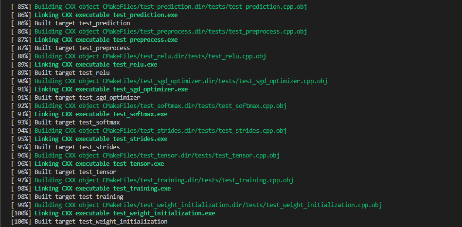
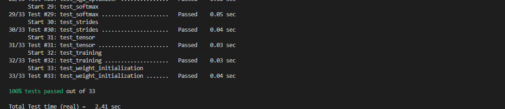

# FINAL PROJECT REPORT
   **GROUP 10**
   **Convolutional Neural Network (CNN) From Scratch in C++**

---

## 1. Executive Summary
This project presents the design, implementation, and validation of a Convolutional Neural Network (CNN) built entirely from scratch in pure C++. By deliberately avoiding high-level deep learning frameworks such as TensorFlow or PyTorch, the team engaged directly with raw memory management, multidimensional tensor mathematics, and the calculus of backpropagation. 

The resulting artifact is a modular, highly reusable static library (`cnn_lib`) featuring a clean functional API, comprehensive unit testing, and demonstrative applications.

### 1.1 Project Objectives
*   **Architectural Integrity:** Design a modular C++ library (`cnn_lib`) with a strictly separated public API (`include/`) and internal implementations (`src/`).
*   **First-Principles Engineering:** Implement OOP principles, contiguous memory allocation, and mathematical formulations without external matrix libraries.
*   **Rigorous Validation:** Verify every component using 33 dedicated unit tests driven by CMake and CTest.

---

## 2. Library Architecture

### 2.1 Directory Structure
The project adheres to professional C++ directory conventions, ensuring that the core logic is entirely decoupled from the test suites and demonstration programs.

```text
ConvolutionalNeuralNetwork/
├── CMakeLists.txt
├── include/                  # Public API headers
│   ├── tensor.hpp
│   ├── conv2d.hpp
│   ├── pooling.hpp
│   ├── fully_connected.hpp
│   └── ...
├── src/                      # Internal C++ implementations
│   └── ...
├── tests/                    # 33 Unit Test suites
│   └── ...
├── examples/                 # Demonstration applications
│   └── cnn_final_app.cpp
└── reports/                  # Project documentation
```

### 2.2 Design Paradigm
The library utilizes a **Functional API** for its mathematical operations. Rather than relying on hidden global state, functions such as `fullyConnectedBackward()` accept weights, inputs, and upstream gradients as arguments, returning the computed gradients. This stateless design ensures the library is thread-safe, predictable, and highly reusable.

---

## 3. Class Deconstruction & Implementation Details

### Module A: The Core Tensor Class (`Tensor`)
1. **Creation:** `Tensor` (representing 4D data blocks: \(N \times C \times H \times W\)).
2. **Rationale:** To store raw images and feature maps in contiguous memory blocks, facilitating efficient multidimensional indexing across batch size, channels, and spatial dimensions.
3. **Data Held:** 
    *   `vector<double> data`: A 1D contiguous vector storing all floating-point values.
    *   `vector<size_t> shape`: Dimensions vector `{N, C, H, W}`.
4. **Core Functions:**
    *   `Tensor(...)`: Allocates memory based on the requested shape.
    *   `operator()(n, c, h, w)`: Provides multi-index element access.
    *   Flattening and gradient allocation helpers.
5. **Encapsulation:** Public indexing operators allow seamless interaction from convolutional layers, while the raw `data` vector remains encapsulated to prevent unintended memory corruption.

### Module B: Two-Dimensional Convolution (`Conv2D`)
1. **Creation:** `Conv2D` (handles multi-channel convolution, kernels, strides, and zero-padding).
2. **Rationale:** To extract spatial features from input tensors using learnable filter weights.
3. **Data Held:** `Tensor weights` \((out\_channels, in\_channels, k\_h, k\_w)\), `Tensor biases`, and spatial hyperparameters (`stride`, `padding`).
4. **Core Functions:** `forward()` computes sliding-window dot products; `backward()` computes gradients with respect to weights, biases, and inputs.
5. **Encapsulation:** Intermediate cache states (like padded inputs) are kept private to ensure the mathematical state is preserved securely during backpropagation.

### Module C: Pooling Layers (`Pooling`)
1. **Creation:** `Pooling` (supports Max and Average Pooling).
2. **Rationale:** To downsample feature maps, reduce spatial dimensions, and introduce translational invariance.
3. **Data Held:** Configuration parameters (`pool_size`, `stride`) and the pooling `mode`.
4. **Core Functions:** `forward()` extracts max/average values; `backward()` routes gradients exclusively to the positions of the original maximum values.
5. **Encapsulation:** Index tracking matrices used during the backward pass are protected to prevent external tampering.

### Module D: Fully Connected Layer (`FullyConnected`)
1. **Creation:** `FullyConnected` (Dense layer).
2. **Rationale:** To map flattened feature representations into final class logits for classification.
3. **Data Held:** `weights`, `biases`, and cached inputs/outputs.
4. **Core Functions:** `forward()` handles the matrix multiplication \(z = Wx + b\); `backward()` computes weight/bias gradients and propagates the error.
5. **Encapsulation:** Weight initialization states and intermediate activation caches are kept strictly private.

---

## 4. Build & Compilation Success
The project utilizes CMake to build the static `cnn_lib` and link it against the examples and tests. The build pipeline guarantees strict adherence to C++17 standards (`-Wall -Wextra -Wpedantic`). 

The following figure demonstrates a clean, error-free compilation of the entire library, all 33 test executables, and the demonstration applications.


*(Figure 1: Terminal output confirming a 100% successful build across all targets.)*

---

## 5. Testing Approach & Results

### 5.1 Testing Framework
A custom C++ unit testing framework was developed and integrated with CMake and CTest. The testing suite ensures that memory boundaries, gradient calculations, and spatial dimensions are mathematically exact.

### 5.2 Test Coverage
**33 dedicated test suites** cover every module:
*   **Core Math:** Tensor allocation, indexing, and strides.
*   **Spatial Layers:** Padding, single/multi-channel convolutions, max/average pooling.
*   **Dense Layers:** Fully connected forward/backward passes, Softmax numerical stability, and Cross-Entropy loss.
*   **Optimization:** Complete backpropagation loops and SGD optimization.

### 5.3 Results
The testing suite executes in under 2 seconds and yields a **100% pass rate (33/33 tests passed)**.


*(Figure 2: CTest execution results confirming 100% test success.)*

---

## 6. Team Contributions & Collaboration
*   **Frank (Team Lead):** Dataset parsing, image loading engine, loss gradients, Softmax backprop.
*   **Peter (Operations Lead):** Image preprocessing, stride mechanics, Fully Connected forward pass.
*   **Jeremy:** Image representation structures, ReLU activation, Xavier/He weight initialization.
*   **Agatha:** Tensor vector math, Sigmoid/Tanh activations, Softmax numerical stability.
*   **Mugarura:** Filter initialization, Max Pooling, Cross-Entropy loss.
*   **Joan:** 2D convolution sliding window math, Average Pooling, Argmax prediction.
*   **Evarista:** Multi-channel convolution, Feature extraction blocks, SGD optimizer.
*   **Edrine (Integration Lead):** Convolution pipeline integration, Mini-batch training loop, and final application packaging.

---

## 7. AI Use Declaration
*   **Tool:** Advanced AI assistant (Gemini).
*   **Purpose:** Architecture brainstorming, debugging memory boundaries in convolution loops, reviewing C++ tensor indexing formulas, and structuring documentation guidelines.
*   **Reason:** To accelerate syntax verification and ensure adherence to clean C++ design patterns while maintaining full team comprehension of all code written.